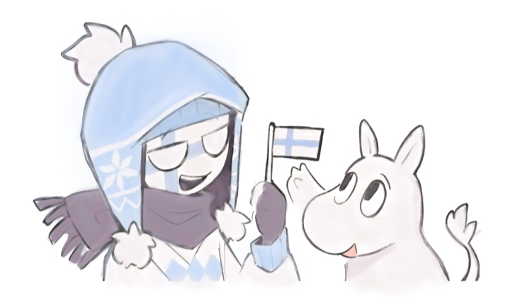
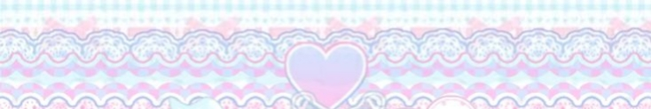

  

  

$$
\begin{array}{lcl}
{\color{#f2b9d0} \text{𝓃𝑜𝓃-𝒷𝒾𝓃𝒶𝓇𝓎      ♡  }} & \hspace{6em} & {\color{#bfe6ff} \text{𝒹𝑜𝓁9𝒽𝒾𝓃𝓃}} \\
\\
& {\color{#bfe6ff} \text{aroace }\heartsuit} & \\
\\
{\color{#fcf9ee} \text{𝒻𝒾𝓃𝓃𝒾𝓈𝒽` }\heartsuit} & \hspace{2em} & {\color{#f2b9d0} \text{𝒹𝑜 u 𝒻𝑒𝑒𝓁 gu𝒾𝓉𝓉𝓎?}} 
\end{array}
$$

  

${{\color{#bfe6ff} my countryy`
             }}$
             
${{\color{#bfe6ff} HEAT SHOT` ° !
             }}$
             
${{\color{#f2b9d0} ALL-THOSE-IMAGE-NOT -MINE
             }}$

[@my-town](https://github.com) | [@dorfiical-contributors](https://github.com)

  

