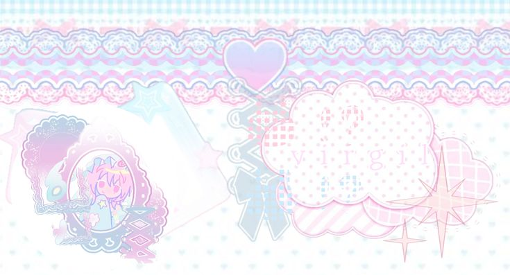
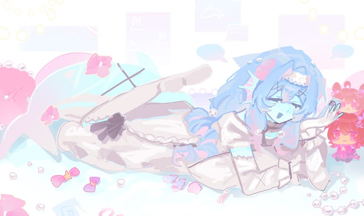

  

  

${{\color{#f2b9d0}  non-binary
                    }}$
${{\color{#f9fcf8}  aroace 
                    }}$
                    
        ${{\color{#bfe6ff} what else do you see?
                    }}$

     ${{\color{#f2b9d0}  what else do u see?
                    }}$         
                    
[@my-town](https://github.com) | [@dorfiical-contributors](https://github.com)

